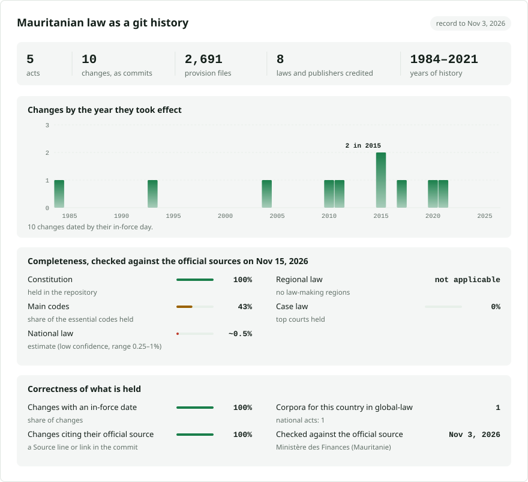

# Mauritania: law history in git

[Français](README.md) · **English**

<picture>
<source media="(prefers-color-scheme: dark)" srcset="data/effort-dark.svg">

</picture>

The law of Mauritania as a git history: one file per article, one commit per version on the day it took effect, and the law that made each change as the commit's author. `git blame` names the law behind every paragraph; `git log` lists every change to an article; picking a date gives the text in force that day.

Part of [lexifina/global-law](https://github.com/lexifina/global-law), one git history for every country's law: this is Mauritania's national law, which global-law reads at `mauritania/national/acts/`.

**What is in it now:** the Constitution (1991, as revised to 2017), the Code pénal, the Code de commerce, the Code du travail, the civil-service statute (six versions) and 853 other texts, each in the oldest version available: 166 laws (including the finance laws since 1959), 32 ordinances, 402 decrees, 252 orders and 1 decisions of the regulatory authority; 12 texts also carry their official Arabic text (`<act>/ar/`). [`corpus.json`](corpus.json) lists them with their dates and sources; [`STRUCTURE.md`](STRUCTURE.md) describes the layout.

Each act is a folder, filed by kind and year (`codes/<code>/`, `lois/<année>/<numéro>-<objet>/`, `ordonnances/`, `decrets/`, `arretes/`), with one file per article, `art-NNN.md` (`lois/1993/93-09-statut-general-des-fonctionnaires/art-002.md` is Article 2 of the civil-service statute, loi n° 93-09); each folder's `README.md` lists its articles and when each last changed.

The text is in French, as the sources print it. The Arabic text and an English translation are not part of this record.

## Questions as git commands

| Question | Command |
| --- | --- |
| Every change to Article 2 of the civil-service statute | `git log -p --word-diff -- lois/1993/93-09-statut-general-des-fonctionnaires/art-002.md` |
| Which law wrote each line of Article 2? | `git blame lois/1993/93-09-statut-general-des-fonctionnaires/art-002.md` |
| Every version of the statute, with the day each took effect | `git log --format="%h %(trailers:key=In-force,valueonly,separator=) %an" -- "lois/1993/93-09-statut-general-des-fonctionnaires/art-*"` |
| Article 2 as in force on 1 January 2015 | `python tools/on.py 2015-01-01 lois/1993/93-09-statut-general-des-fonctionnaires art-002` |

**Outside git**, we also host this record publicly, for free:

- **[Ask Claude about Mauritanian law](https://global-law.lexifina.com/v1/try_claude?country=mauritania)**: opens Claude with a first question ready.
- **[Ask ChatGPT](https://global-law.lexifina.com/v1/try_chatgpt?country=mauritania)**: the same question in ChatGPT.
- **[Search Mauritanian law on our site](https://lexifina.com/law?country=mauritania&q=cong%C3%A9+annuel)**: a search for "congé annuel", with each provision's text and its versions, no account needed.
- **[Developer REST API](https://global-law.lexifina.com/v1/search_law?query=cong%C3%A9+annuel&jurisdiction=mauritania)**: the same search as JSON, with no key. See the [documentation here](https://lexifina.com/api/global-law).

Both assistants read the record through the free Global law connector (MCP, `https://global-law.lexifina.com/mcp`); the first time, the chat gives you the link that adds it. Ask in French or in English.

**Host it yourself easily.** All it takes is git and Python, and the tools run on your machine:

```sh
git clone --depth 1 https://github.com/lexifina/global-law && cd global-law
python3 tools/countries.py add mauritania/national/acts
python3 tools/law.py show 2026-01-01 mauritania/national/acts/lois/1993/93-09-statut-general-des-fonctionnaires/art-002.md
```

Opened in Claude Code, Cursor, VS Code or Codex, the clone also starts a local MCP server with the same tools ([MCP.md](https://github.com/lexifina/global-law/blob/main/MCP.md)).

## Dates

Each commit is dated at noon, Africa/Nouakchott, on the day the version took effect, and carries it in its `In-force:` trailer:

- the civil-service statute and its amending laws: the promulgation date each official PDF prints, since none states a separate commencement day or Journal officiel date; the Code du travail: 6 July 2004, the date of loi n° 2004-017;
- the Code pénal: 29 February 1984, the Journal officiel (n° 608-609) in which WIPO Lex gives it entering into force; the Code de commerce: 30 November 2015, the day loi n° 2015-32 took effect, per WIPO Lex;
- the other laws, ordinances, decrees and orders: the date of the text in its title (promulgation or signature); their sources do not give the Journal officiel date;
- the Constitution: 15 August 2017, the day of the constitutional laws n° 2017-021 and 2017-022 named in its title; the consolidated text gives no date of its own.

Acts were added in batches, so `git log` over the whole repository is not in date order; the `In-force:` trailer gives each version's day.

Each version is credited to the law that made it (`Loi n° 2021-010 <loi-2021-010@finances.gov.mr.invalid>`); the Constitution, the Code pénal and the Code de commerce, here only in the oldest version available, are credited to the publisher, `Ministère des Finances (Mauritanie)`. The committer is Lexifina.

## How it is checked

- Every version is read back from git on the day it took effect and on the day before, and must match the corpus it was built from, file by file (`tools/check_repo.py`); the results are in [`REPRODUCE.md`](REPRODUCE.md).
- Every text comes from a PDF's text layer; the Code du travail was checked paragraph by paragraph against its PDF, and the statute's six PDFs (40 pages) have no image-only pages.
- The same corpus always gives the same commit hashes: a second build into an empty folder gave identical ones, and `REPRODUCE.md` gives the corpus's sha256 and the builders' blob hashes.
- History is append-only: no merge commits, no commit dated after the build, and every commit's trailers parse.
- [vulnerabilities/](vulnerabilities/README.en.md): possible drafting mistakes in this law, found by global-law's detectors and checked by hand. Not run yet.

## What it does not show

- **Much of Mauritanian law.** The Journal officiel and the "Codes usuels de Mauritanie" of the Secrétariat général du Gouvernement (msgg.gov.mr) are not used: its legal notice forbids any reproduction without prior express permission. Missing as a result are, among others, the Code de procédure pénale, the Code du statut personnel and the Code des obligations et des contrats. Texts published as scans without a text layer are left out (360 so far; no OCR). The other texts are in the oldest version available, without later amendments. Decisions of the Conseil constitutionnel are in a separate, private repository.
- **Later amendments, for four acts.** The Code pénal is the 1983 ordinance as published (later changes, such as to article 306 in 2018, are not applied); the Code du travail is loi n° 2004-017 as enacted (loi n° 2022-025 and earlier amending laws are not applied). The Constitution and the Code de commerce are one consolidated text each; their earlier texts are not separate versions.
- **Transitional rules.** Article 2 of loi n° 2020-020 applies its changes only to staff not retired before 1 July 2020; that rule is not written into the statute's text.
- **Headings.** Livre, Titre, Chapitre and Section headings are left out, and paragraph breaks are rebuilt from the PDF's line layout, so a few paragraphs that print separates may be joined.
- **Article 98 of the Code du travail** is printed twice in the source; both are kept, the second as `codes/code-du-travail/art-098-dup2.md`.

## Sources

| Source | Kind | Past versions | Notes |
| --- | --- | --- | --- |
| [Ministère des Finances](https://finances.gov.mr) | Official texts published by the Ministry, PDFs with a text layer | the Constitution as consolidated; each law as enacted | The Constitution, the Code du travail, and the civil-service statute with its five amending laws |
| [Ministère des Finances, Recueil des textes](https://finances.gov.mr/Recueil_des_textes_relatifs_a_la_mission_du_Ministere/) | Official PDFs, one per text | each text as published | 270 laws, decrees and orders (budget, finance laws, pensions, allowances, civil service) |
| [FAOLEX](https://www.fao.org/faolex/) (FAO) | Secondary copies of official texts, PDFs with a text layer | each text as published | 482 texts (land, water, fisheries, mining, environment, health…); `Source-status: secondary copy` trailer |
| [Ministère des Finances, Lois / Décrets / Arrêtés pages](https://www.finances.gov.mr/fr/Lois) | Official PDFs, French and Arabic | each text as published | finance laws, organic budget law, budget and accounting decrees and orders; bills left out |
| [Autorité de Régulation](https://www.are.mr) | Official PDFs of its reference texts (telecoms, electricity, water, post) | each text as published | laws, decrees, regulatory orders and CNR decisions; licences, specifications and sanctions left out; recent scans without a text layer left out |
| [Cour suprême](https://coursupreme.mr), [Présidence](https://www.presidence.mr), [Primature](https://www.primature.gov.mr), [Fonction publique](https://www.fonctionpublique.gov.mr) and other ministries | Official PDFs, mostly Arabic | each text as published | Arabic texts (`ar/`) and texts not available in French; unreadable Arabic text layers left out |
| [WIPO Lex](https://www.wipo.int/wipolex/) | Official texts republished by WIPO, PDFs with a text layer | one text each | The Code pénal as published (MR004) and the Code de commerce as amended in 2015 (MR028) |

## Licence

See [`LICENSE`](LICENSE). The legal text is copied from the official PDFs, or the copies (FAOLEX, WIPO Lex), it names; the wording of the law is not changed, and the publishers do not endorse this repository. Lexifina's own contributions (the arrangement of the history, the commit messages, the tables and the tools) are dedicated to the public domain under CC0 1.0.

No AI model wrote, translated or corrected legal text, and none runs at build time; the scripts were written by AI models, Claude Code and Codex (see [`REPRODUCE.md`](REPRODUCE.md)).

## Visualisations

- [visualisations/](visualisations/README.en.md): charts drawn from this repository. Not drawn yet.

## More

From [lexifina/global-law](https://github.com/lexifina/global-law):

- [FEATURES.md](https://github.com/lexifina/global-law/blob/main/FEATURES.md): every feature, and what every corpus must support (`git blame`, `law.py`, the MCP tools)
- [FAQ.md](https://github.com/lexifina/global-law/blob/main/FAQ.md): questions and answers · [CONTRIBUTING.md](https://github.com/lexifina/global-law/blob/main/CONTRIBUTING.md): proposing changes · [MCP.md](https://github.com/lexifina/global-law/blob/main/MCP.md): the MCP server · [REPRODUCE.md](https://github.com/lexifina/global-law/blob/main/REPRODUCE.md): how it was built · [CHANGELOG.md](https://github.com/lexifina/global-law/blob/main/CHANGELOG.md)
- [FRESHNESS.md](https://github.com/lexifina/global-law/blob/main/FRESHNESS.md): how current each corpus is · [Monitoring](https://github.com/lexifina/global-law/tree/main/monitoring): whether updates are running · [WATCHING.md](https://github.com/lexifina/global-law/blob/main/WATCHING.md): how each official source is watched for changes
- [performance/](https://github.com/lexifina/global-law/tree/main/performance): how fast the tools are, measured
- [visualisations/](https://github.com/lexifina/global-law/tree/main/visualisations): charts and bridges across the world's law
- [Vulnerabilities](https://github.com/lexifina/global-law/tree/main/vulnerabilities): mistakes in legislation as published
