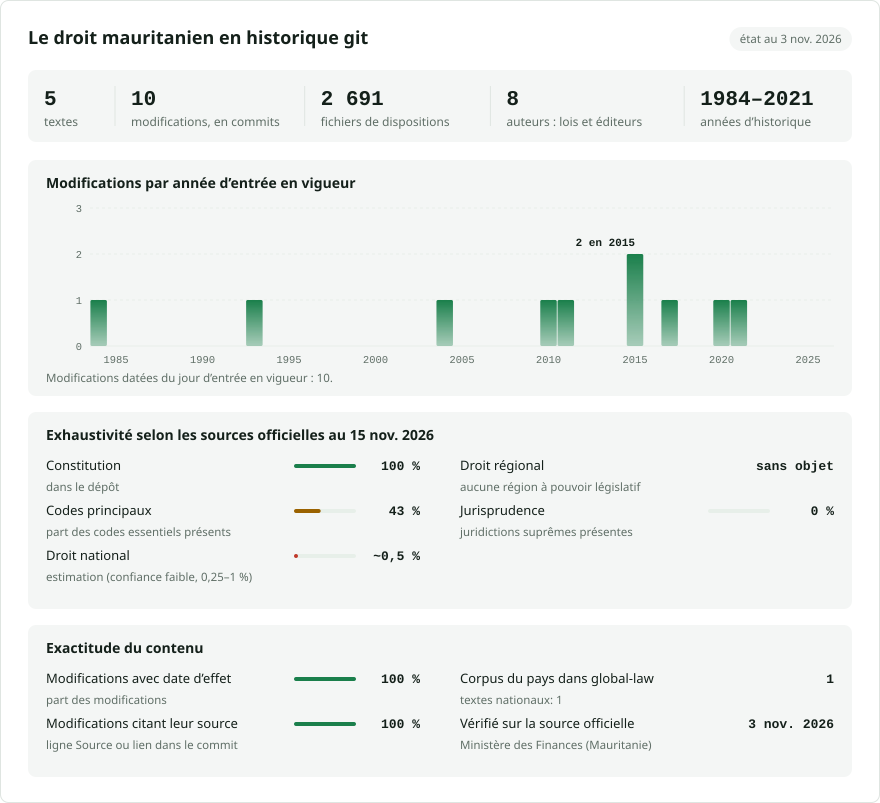

# Mauritanie : l’histoire du droit dans git

**Français** · [English](README.en.md)

<picture>
<source media="(prefers-color-scheme: dark)" srcset="data/fr/effort-dark.svg">

</picture>

Le droit de la Mauritanie sous la forme d’un historique git : un fichier par article, un commit par version à la date de son entrée en vigueur, et la loi auteur de chaque modification comme auteur du commit. `git blame` indique la loi à l’origine de chaque alinéa ; `git log` liste toutes les modifications d’un article ; le choix d’une date donne le texte en vigueur ce jour-là.

Fait partie de [lexifina/global-law](https://github.com/lexifina/global-law), un historique git unique pour le droit de tous les pays : il s’agit ici du droit national de la Mauritanie, que global-law lit sous `mauritania/national/acts/`.

**Contenu actuel :** la Constitution (1991, révisée jusqu’en 2017), le Code pénal, le Code de commerce, le Code du travail, le statut général de la fonction publique (six versions) et 752 autres textes, chacun dans sa plus ancienne version disponible : 137 lois (dont les lois de finances depuis 1959), 30 ordonnances, 361 décrets et 224 arrêtés. [`corpus.json`](corpus.json) les liste avec leurs dates et leurs sources ; [`STRUCTURE.md`](STRUCTURE.md) décrit le classement.

Chaque texte est un dossier, rangé par nature et par année (`codes/<code>/`, `lois/<année>/<numéro>-<objet>/`, `ordonnances/`, `decrets/`, `arretes/`), avec un fichier par article, `art-NNN.md` (`lois/1993/93-09-statut-general-des-fonctionnaires/art-002.md` est l’article 2 du statut de la fonction publique, loi n° 93-09) ; le `README.md` de chaque dossier liste ses articles et la date de la dernière modification de chacun.

Le texte est en français, tel que les sources l’impriment. Le texte arabe et une traduction anglaise ne font pas partie de ce corpus.

## Questions sous forme de commandes git

| Question | Commande |
| --- | --- |
| Toutes les modifications de l’article 2 du statut de la fonction publique | `git log -p --word-diff -- lois/1993/93-09-statut-general-des-fonctionnaires/art-002.md` |
| Quelle loi a rédigé chaque ligne de l’article 2 ? | `git blame lois/1993/93-09-statut-general-des-fonctionnaires/art-002.md` |
| Toutes les versions du statut, avec la date d’entrée en vigueur de chacune | `git log --format="%h %(trailers:key=In-force,valueonly,separator=) %an" -- "lois/1993/93-09-statut-general-des-fonctionnaires/art-*"` |
| L’article 2 tel qu’en vigueur au 1er janvier 2015 | `python tools/on.py 2015-01-01 lois/1993/93-09-statut-general-des-fonctionnaires art-002` |

**En dehors de git**, nous hébergeons aussi ce corpus publiquement, gratuitement :

- **[Interroger Claude sur le droit mauritanien](https://global-law.lexifina.com/v1/try_claude?country=mauritania)** : ouvre Claude avec une première question prête.
- **[Interroger ChatGPT](https://global-law.lexifina.com/v1/try_chatgpt?country=mauritania)** : la même question dans ChatGPT.
- **[Rechercher dans le droit mauritanien sur notre site](https://lexifina.com/law?country=mauritania&q=cong%C3%A9+annuel)** : une recherche de « congé annuel », avec le texte de chaque disposition et ses versions, sans compte.
- **[API REST pour développeurs](https://global-law.lexifina.com/v1/search_law?query=cong%C3%A9+annuel&jurisdiction=mauritania)** : la même recherche au format JSON, sans clé. Voir la [documentation ici](https://lexifina.com/api/global-law).

Les deux assistants lisent le corpus au moyen du connecteur gratuit Global law (MCP, `https://global-law.lexifina.com/mcp`) ; la première fois, la conversation vous donne le lien qui l’ajoute. Posez vos questions en français ou en anglais.

**L’héberger vous-même, simplement.** Il suffit de git et de Python, et les outils s’exécutent sur votre machine :

```sh
git clone --depth 1 https://github.com/lexifina/global-law && cd global-law
python3 tools/countries.py add mauritania/national/acts
python3 tools/law.py show 2026-01-01 mauritania/national/acts/lois/1993/93-09-statut-general-des-fonctionnaires/art-002.md
```

Ouvert dans Claude Code, Cursor, VS Code ou Codex, le clone démarre aussi un serveur MCP local doté des mêmes outils ([MCP.md](https://github.com/lexifina/global-law/blob/main/MCP.md)).

## Dates

Chaque commit est daté à midi, heure Africa/Nouakchott, du jour où la version est entrée en vigueur, et porte cette date dans son trailer `In-force:` :

- le statut de la fonction publique et ses lois modificatives : la date de promulgation imprimée sur chaque PDF officiel, aucun n’indiquant de date d’entrée en vigueur distincte ni de date de Journal officiel ; le Code du travail : le 6 juillet 2004, date de la loi n° 2004-017 ;
- le Code pénal : le 29 février 1984, date du Journal officiel (n° 608-609) à laquelle WIPO Lex le fait entrer en vigueur ; le Code de commerce : le 30 novembre 2015, date d’entrée en vigueur de la loi n° 2015-32 selon WIPO Lex ;
- les autres lois, ordonnances, décrets et arrêtés : la date du texte dans son intitulé (promulgation ou signature) ; leurs sources ne donnent pas la date du Journal officiel ;
- la Constitution : le 15 août 2017, date des lois constitutionnelles n° 2017-021 et 2017-022 citées dans son intitulé ; le texte consolidé ne porte pas de date propre.

Les textes ont été ajoutés par lots, de sorte que `git log` sur l’ensemble du dépôt ne suit pas l’ordre chronologique ; le trailer `In-force:` donne la date de chaque version.

Chaque version est attribuée à la loi qui l’a opérée (`Loi n° 2021-010 <loi-2021-010@finances.gov.mr.invalid>`) ; la Constitution, le Code pénal et le Code de commerce, présents ici uniquement dans la plus ancienne version disponible, sont attribués à l’éditeur, `Ministère des Finances (Mauritanie)`. Le committer est Lexifina.

## Méthode de vérification

- Chaque version est relue dans git le jour de son entrée en vigueur et la veille, et doit correspondre, fichier par fichier, au corpus à partir duquel elle a été construite (`tools/check_repo.py`) ; les résultats figurent dans [`REPRODUCE.md`](REPRODUCE.md).
- Chaque texte provient de la couche texte d’un PDF ; le Code du travail a été vérifié paragraphe par paragraphe par rapport à son PDF, et les six PDF du statut (40 pages) ne comportent aucune page constituée uniquement d’images.
- Un même corpus donne toujours les mêmes empreintes de commit : une seconde construction dans un dossier vide a donné des empreintes identiques, et `REPRODUCE.md` donne l’empreinte sha256 du corpus et les empreintes de blob des scripts de construction.
- L’historique ne fait que s’allonger : aucun commit de fusion, aucun commit daté après la construction, et les trailers de chaque commit sont analysables.
- [vulnerabilities/](vulnerabilities/): erreurs de rédaction possibles dans ce droit, trouvées par les détecteurs de global-law et vérifiées à la main. Pas encore lancé.

## Ce qu’il ne montre pas

- **Une grande partie du droit mauritanien.** Le Journal officiel et les « Codes usuels de Mauritanie » du Secrétariat général du Gouvernement (msgg.gov.mr) ne sont pas repris : leurs mentions légales interdisent toute reproduction sans autorisation préalable et expresse. Manquent notamment le Code de procédure pénale, le Code du statut personnel et le Code des obligations et des contrats. Les textes publiés en scans sans couche texte sont écartés (360 à ce jour ; aucun OCR). Les autres textes figurent dans leur plus ancienne version disponible, sans leurs modifications ultérieures. Les décisions du Conseil constitutionnel sont dans un dépôt distinct, privé.
- **Les modifications ultérieures, pour quatre textes.** Le Code pénal est l’ordonnance de 1983 telle que publiée (les modifications ultérieures, comme celle de l’article 306 en 2018, ne sont pas appliquées) ; le Code du travail est la loi n° 2004-017 telle qu’adoptée (la loi n° 2022-025 et les lois modificatives antérieures ne sont pas appliquées). La Constitution et le Code de commerce sont chacun un texte consolidé unique ; leurs textes antérieurs ne constituent pas des versions distinctes.
- **Les dispositions transitoires.** L’article 2 de la loi n° 2020-020 n’applique ses modifications qu’aux agents non admis à la retraite avant le 1er juillet 2020 ; cette règle n’est pas inscrite dans le texte du statut.
- **Les intitulés.** Les intitulés des Livres, Titres, Chapitres et Sections sont omis, et les sauts de paragraphe sont reconstitués à partir de la mise en page des lignes du PDF ; quelques paragraphes que l’imprimé sépare peuvent donc se trouver réunis.
- **L’article 98 du Code du travail** est imprimé deux fois dans la source ; les deux sont conservés, le second sous `codes/code-du-travail/art-098-dup2.md`.

## Sources

| Source | Nature | Versions antérieures | Remarques |
| --- | --- | --- | --- |
| [Ministère des Finances](https://finances.gov.mr) | Textes officiels publiés par le Ministère, PDF dotés d’une couche texte | la Constitution telle que consolidée ; chaque loi telle qu’adoptée | La Constitution, le Code du travail et le statut de la fonction publique avec ses cinq lois modificatives |
| [Ministère des Finances, Recueil des textes](https://finances.gov.mr/Recueil_des_textes_relatifs_a_la_mission_du_Ministere/) | PDF officiels, un par texte | chaque texte tel que publié | 270 lois, décrets et arrêtés (budget, lois de finances, pensions, indemnités, fonction publique) |
| [FAOLEX](https://www.fao.org/faolex/) (FAO) | Copies secondaires de textes officiels, PDF dotés d’une couche texte | chaque texte tel que publié | 482 textes (foncier, eau, pêche, mines, environnement, santé…) ; trailer `Source-status: secondary copy` |
| [WIPO Lex](https://www.wipo.int/wipolex/) | Textes officiels republiés par l’OMPI, PDF dotés d’une couche texte | un texte chacun | Le Code pénal tel que publié (MR004) et le Code de commerce tel que modifié en 2015 (MR028) |

## Licence

Voir [`LICENSE`](LICENSE). Le texte juridique est copié des PDF officiels ou des copies (FAOLEX, WIPO Lex) qui y sont cités ; la formulation de la loi n’est pas modifiée, et les éditeurs n’approuvent pas ce dépôt. Les contributions propres de Lexifina (l’organisation de l’historique, les messages de commit, les tableaux et les outils) sont versées dans le domaine public sous CC0 1.0.

Aucun modèle d’IA n’a rédigé, traduit ni corrigé de texte juridique, et aucun ne s’exécute lors de la construction ; les scripts ont été écrits par des modèles d’IA, Claude Code et Codex (voir [`REPRODUCE.md`](REPRODUCE.md)).

Ceci est une traduction de la version anglaise ([README.en.md](README.en.md)) ; en cas de divergence, la version anglaise fait foi.

## Visualisations

- [visualisations/](visualisations/): graphiques tirés de ce dépôt. Pas encore dessinés.

## En savoir plus

Dans le dépôt [lexifina/global-law](https://github.com/lexifina/global-law) (pages en anglais) :

- [FEATURES.md](https://github.com/lexifina/global-law/blob/main/FEATURES.md): toutes les fonctionnalités et ce que chaque corpus doit prendre en charge (`git blame`, `law.py`, outils MCP)
- [FAQ.md](https://github.com/lexifina/global-law/blob/main/FAQ.md): questions et réponses · [CONTRIBUTING.md](https://github.com/lexifina/global-law/blob/main/CONTRIBUTING.md): proposer une modification · [MCP.md](https://github.com/lexifina/global-law/blob/main/MCP.md): serveur MCP · [REPRODUCE.md](https://github.com/lexifina/global-law/blob/main/REPRODUCE.md): comment il a été construit · [CHANGELOG.md](https://github.com/lexifina/global-law/blob/main/CHANGELOG.md)
- [FRESHNESS.md](https://github.com/lexifina/global-law/blob/main/FRESHNESS.md): à quel point chaque corpus est à jour · [Surveillance](https://github.com/lexifina/global-law/tree/main/monitoring): si les mises à jour fonctionnent · [WATCHING.md](https://github.com/lexifina/global-law/blob/main/WATCHING.md): comment chaque source officielle est surveillée pour repérer les modifications
- [performance/](https://github.com/lexifina/global-law/tree/main/performance): la rapidité des outils, mesurée
- [visualisations/](https://github.com/lexifina/global-law/tree/main/visualisations): graphiques et liens à travers le droit du monde entier
- [Vulnérabilités](https://github.com/lexifina/global-law/tree/main/vulnerabilities): erreurs dans les textes tels qu’ils ont été publiés
